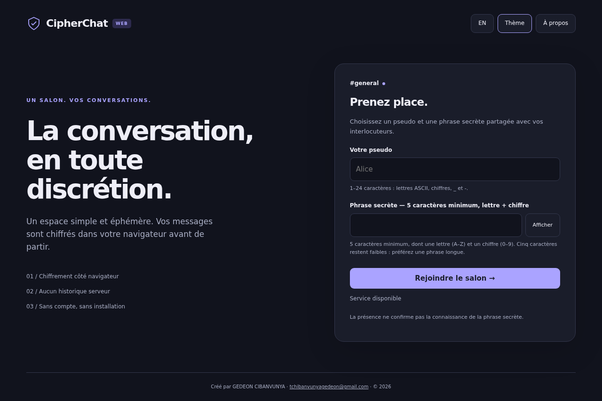

# CipherChat Web

**Messagerie temps réel · Chiffrement côté navigateur · FR / EN**

[Version Web](https://github.com/GedeonTch/CipherChat) · [Version CLI](https://github.com/GedeonTch/CipherChat-CLI) · [Installation](#installation-locale) · [Sécurité](#chiffrement-et-protocole)

Une messagerie Web légère, bilingue et éphémère dans un salon unique **#general**. Chiffrement des messages dans le navigateur, sans compte, base de données ni historique serveur.

> **En ligne :** [Ouvrir CipherChat](https://cipherchat-0fhm.onrender.com) · [État du service](https://cipherchat-0fhm.onrender.com/health)
> Le service gratuit peut démarrer lentement après une période de veille.



## Deux versions du projet

| Version | Interface | Dépôt |
|---|---|---|
| **Web — ce dépôt** | Navigateur, interface responsive et WebSocket | [GedeonTch/CipherChat](https://github.com/GedeonTch/CipherChat) |
| **CLI** | Ligne de commande | [GedeonTch/CipherChat-CLI](https://github.com/GedeonTch/CipherChat-CLI) |

La version CLI est proposée dans un dépôt distinct. Les instructions ci-dessous concernent uniquement la version Web ; les fonctionnalités et configurations des deux versions ne doivent pas être considérées comme identiques.

## Fonctionnalités

- Pseudos uniques pendant leur connexion, liste des membres et événements d'arrivée/départ.
- Messages temps réel WebSocket, chiffrement AES-256-GCM et métadonnées authentifiées.
- Français par défaut, anglais au choix, thèmes clair/sombre et responsive.
- `/quit`, heartbeat, reconnexion progressive et détection de séquences incohérentes.
- Aucun historique envoyé à une nouvelle connexion. La page garde temporairement au maximum 500 éléments ; le serveur ne stocke pas les conversations.
- Seules les préférences de langue et thème sont enregistrées localement.

**La phrase secrète ne contrôle pas l'accès au salon.** La présence ne prouve ni sa connaissance ni une identité. Lire [les limites de sécurité](docs/security.md).

## Technologies et structure

Python 3.12+ (tests locaux sur 3.13), FastAPI, Uvicorn, HTML/CSS/JS natifs, Web Crypto. Node.js 20+ pour les tests cryptographiques. Aucun npm install nécessaire.

- `server.py` : lancement et chargement `.env`.
- `app/main.py` : HTTP, WebSocket, membres en mémoire, limites et diffusion.
- `app/settings.py` : configuration au démarrage.
- `app/protocol.py` : schémas stricts des messages.
- `static/` : interface et modules JS (crypto, protocole, connexion, traductions).
- `tests/` : pytest, crypto Node et parcours Chromium.
- `docs/` : protocole, sécurité, déploiement et captures réellement prises pendant les tests.
- `.env.example`, `.gitignore`, `render.yaml` : configuration et préparation au déploiement.

## Installation locale

### Prérequis

- Python **3.12 ou supérieur** et `pip`.
- Git pour récupérer le dépôt.
- Navigateur récent avec Web Crypto (HTTPS ou `localhost`).
- Node.js **20 ou supérieur** pour les tests cryptographiques uniquement.

### Récupérer et installer

Une fois le dépôt publié :

```bash
git clone https://github.com/GedeonTch/CipherChat.git
cd CipherChat
```

Puis :

```bash
python -m venv .venv
source .venv/bin/activate
# Windows PowerShell : .venv\Scripts\Activate.ps1
pip install -r requirements.txt
cp .env.example .env
python -c "import secrets; print(secrets.token_hex(16))"
```

Copier le résultat de génération dans `.env` :

```dotenv
CHAT_KDF_SALT=REMPLACER_PAR_32_CARACTERES_HEXADECIMAUX
ALLOWED_ORIGINS=http://localhost:8000
PORT=8000
```

Ne pas laisser la valeur descriptive ci-dessus : l'application la rejettera. Le sel est **public**, mais `.env` reste exclu de Git par précaution. Générer le sel une seule fois puis le conserver lors des redémarrages et déploiements. Ne jamais configurer la phrase secrète sur le serveur.

```bash
python server.py
```

Ouvrir **http://localhost:8000**. `http://127.0.0.1:8000` est une autre origine : l'ajouter explicitement à ALLOWED_ORIGINS si nécessaire. Liste séparée par des virgules, sans espaces, chemins, joker ni slash final. Les origines non locales doivent utiliser HTTPS.

## Phrase secrète

La phrase partagée doit contenir **au moins 5 caractères**, dont :

- **une lettre ASCII** (`A–Z` ou `a–z`) ;
- **un chiffre** (`0–9`).

Les caractères supplémentaires sont autorisés. Ce minimum reste faible face à une recherche hors ligne : **privilégiez une phrase longue et imprévisible**. Tous les participants souhaitant lire les mêmes messages doivent utiliser la même phrase et le même sel public de configuration.

## Tester plusieurs utilisateurs

1. Ouvrir deux fenêtres/onglets sur la même adresse.
2. Choisir des pseudos différents et la même phrase secrète, selon les règles ci-dessus.
3. Vérifier la présence et envoyer des messages dans les deux sens.
4. Dans une troisième fenêtre, utiliser une phrase différente : la connexion réussit, mais les messages sont rejetés avec un avis d'échec de déchiffrement.
5. Tester `/quit`, le bouton Quitter, FR/EN et les thèmes.

Entrée envoie ; Maj + Entrée ajoute une ligne. Les messages sont limités à 2000 caractères et à la taille finale de paquet de 8 KiB. Certains textes Unicode atteignent la limite de taille avant les 2000 caractères.

## Chiffrement et protocole

PBKDF2-HMAC-SHA256 : **600000 itérations**, sel de 16 octets encodé en 32 caractères hexadécimaux, clé AES-256-GCM non exportable. IV aléatoire de 12 octets pour chaque message, tag GCM 128 bits. Temps de préparation affiché, sans réduction silencieuse des itérations.

Les AAD sont l'encodage UTF-8 du tableau JSON `[v,room,nick,ts,session,seq,id]`. Leur modification fait échouer l'authentification. La phrase ne quitte pas le navigateur dans le protocole normal. Clé en mémoire seulement ; le serveur publie le sel via `/api/config`.

[Format JSON précis et contrôles](docs/protocol.md) · [Menaces, limites, conservation du sel](docs/security.md)

Le serveur voit les métadonnées ; un participant partageant la clé peut fabriquer des messages authentifiés ; une phrase faible permet des recherches hors ligne ; un serveur compromis peut modifier le JavaScript. Aucun contrôle d'accès par phrase, aucune identité vérifiée et aucune promesse de confidentialité absolue.

## Tests

```bash
pip install -r requirements-dev.txt
python -m pytest -q
npm test
# Ou : node --test tests/crypto.test.mjs
```

Parcours navigateur (serveur local déjà lancé avec l'origine localhost autorisée) :

```bash
python -m playwright install chromium
# Linux, si les bibliothèques système sont absentes :
python -m playwright install-deps chromium
python tests/browser_check.py
```

Le parcours utilise trois clients Chromium, vérifie notamment réception, rendu sûr, mauvaise phrase, présence, départ, reconnexion, thèmes, langue, mobile et mouvement réduit. Il régénère les captures de `docs/`.

Dernière exécution locale : **24 tests pytest réussis, 6 tests Node réussis, parcours Chromium réussi**. PBKDF2 mesuré entre environ 98 et 118 ms dans Node sur cette machine ; ce n'est pas un benchmark mobile. Un avertissement de dépréciation Starlette/AnyIO subsiste ; les tests passent. Les versions directes sont fixées, mais les dépendances transitives ne sont pas verrouillées intégralement.

Pas de validation manuelle sur appareils physiques, ni test de charge longue durée. Voir `docs/security.md` pour les scénarios non validés.

## Déploiement Render et surveillance

Voir [la procédure détaillée](docs/deployment.md). Un seul Web Service, frontend et backend sur la même origine, un seul worker. Build : `pip install -r requirements.txt`. Démarrage : `python server.py`. Port fourni par Render, écoute sur `0.0.0.0`.

Configurer un contrôle HTTP externe de `/health` toutes les cinq minutes si le service retenu le permet. Configuration manuelle, pas de surveillance externe créée par ce projet. Render gratuit peut se mettre en veille ou redémarrer : le heartbeat et la surveillance ne garantissent pas une disponibilité continue.

## Liens publics

- Application Render : **https://cipherchat-0fhm.onrender.com**.
- Code source Web : [github.com/GedeonTch/CipherChat](https://github.com/GedeonTch/CipherChat).
- Version CLI : [github.com/GedeonTch/CipherChat-CLI](https://github.com/GedeonTch/CipherChat-CLI).
- L'aperçu de développement de l'environnement de travail n'est pas un déploiement Render.

## Créateur

**Créé par GEDEON CIBANVUNYA**  
Contact : [tchibanvunyagedeon@gmail.com](mailto:tchibanvunyagedeon@gmail.com)  
© 2026

## Variables d’environnement

À renseigner dans `.env` en local et dans **Environment** sur Render. Le fichier `.env` local n’est pas transféré automatiquement à Render.

| Variable | Rôle et valeur attendue |
|---|---|
| `CHAT_KDF_SALT` | Sel public de 16 octets, soit exactement 32 caractères hexadécimaux. Réutiliser la même valeur entre déploiements ; ce n’est ni une phrase secrète ni une clé AES. |
| `ALLOWED_ORIGINS` | Origines exactes autorisées à ouvrir le WebSocket. En production : `https://cipherchat-0fhm.onrender.com`, sans slash final, chemin ou guillemets. En local : `http://localhost:8000`. |
| `PORT` | Port d’écoute ; `8000` en local, fourni automatiquement par Render. |
| `PYTHON_VERSION` | Version Python sélectionnée par Render ; configuration recommandée : `3.12.10`. |

Le sel est publié aux navigateurs pour la dérivation PBKDF2. La phrase secrète et la clé AES restent côté navigateur. La vérification d’Origin n’est pas une authentification utilisateur.

Le contrôle HTTP public `/health` a répondu **200** avec `{"status":"ok"}` lors de la préparation de cette mise à jour. Cela ne certifie ni la disponibilité continue ni un test complet du chat en production. Aucun moniteur externe n’est déclaré configuré.
